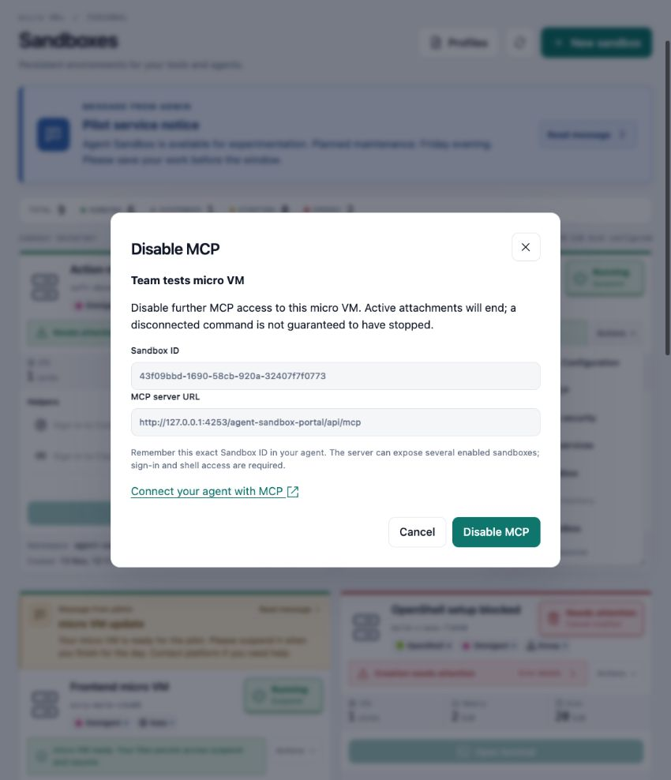

Use the Codex or Claude app, or their CLI clients, to run commands in a remote micro VM through MCP.
One connection can discover all MCP-enabled sandboxes you have shell permission to use.

## 1. Enable your sandbox

1. In the portal, choose **Actions → Enable MCP** on your sandbox and confirm.
2. Select **MCP Enabled** below its resource stats. Copy the **Server URL** and **Sandbox ID**.
   Use the MCP URL, not the portal page URL.
   The connection works whether you open the portal directly or inside CAIPE.



_Example with sample data and a local preview URL. Copy the values from your own portal._

Your operator must first enable MCP and [configure OAuth](mcp-authentication.md).
You sign in with your own account; there is no need to copy a browser cookie or bearer token.

## 2. Connect from the app

### Codex app

1. Open **Settings** and find the **MCP servers** or **Integrations and MCP** section.
2. Add a server named `sandbox-dev`, choose **Streamable HTTP**, and paste the **Server URL**.
3. Save and authenticate. Complete the browser sign-in and consent prompts.
4. Start a new chat and check that the Sandbox tools are available.

Codex app and CLI share MCP configuration on the same host; either setup method is enough.

[Official Codex app settings](https://learn.chatgpt.com/docs/developer-settings#integrations-and-mcp)

### Claude app (desktop or web)

1. Open **Customize → Connectors → Add custom connector**.
2. Name it `sandbox-dev` and paste the **Server URL**.
3. Choose OAuth sign-in and follow the browser sign-in and consent prompts. If asked for a client
   registration method, use **Register automatically** when your operator supports DCR; otherwise
   use the client details they provide.
4. Enable the connector for your conversation from **+ → Connectors**.

For managed team accounts, an organisation administrator may need to add the connector first.
Claude's remote connectors connect from Anthropic's servers: the MCP endpoint must be reachable
from there, even when using the desktop app.

[Official Claude connector setup](https://support.claude.com/en/articles/11175166-get-started-with-custom-connectors-using-remote-mcp)

<details>
<summary>Prefer the CLI? Codex CLI and Claude Code</summary>

In your local terminal, set the **Server URL** you copied, replacing this example:

```bash
export SANDBOX_MCP_URL='https://sandbox.example.com/apps/sandbox/api/mcp'
```

**Codex CLI:**

```bash
codex mcp add sandbox-dev --url "$SANDBOX_MCP_URL"
codex mcp login sandbox-dev --scopes sandbox:mcp
```

Complete browser sign-in and consent, then start a new session and check `/mcp`.
`sandbox:mcp` is the default scope; use your operator's scope if it differs.

**Claude Code:**

```bash
claude mcp add --transport http --scope user sandbox-dev "$SANDBOX_MCP_URL"
```

Start Claude Code, enter `/mcp`, select **sandbox-dev → Authenticate**, and complete browser sign-in.
`--scope user` makes the connection available across your local projects, without sharing it with others.

[Codex CLI reference](https://developers.openai.com/codex/mcp) ·
[Claude Code reference](https://code.claude.com/docs/en/mcp#authenticate-with-remote-mcp-servers)

</details>

## 3. Try a command

Paste this into your agent, replacing the placeholder with the **Sandbox ID** you copied:

```text
Use only the sandbox-dev MCP connection to list my enabled sandboxes.
Select sandbox_id <paste Sandbox ID here>.
Remember this immutable ID and include it in every sandbox tool call.
Run pwd and uname -a there. Show stdout, stderr and the exit code.
```

The result should contain your sandbox's ID and remote command output. Display names can change;
keep using the immutable ID. For longer commands, ask the agent to run in the background and poll
the returned session ID. See the [available tools](mcp.md#tools).

## Switch between dev and production

Keep two connections instead of changing the URL on an authenticated connection:

| Connection     | Server URL                                    |
| -------------- | --------------------------------------------- |
| `sandbox-dev`  | Copy from the dev portal's MCP dialog.        |
| `sandbox-prod` | Copy from the production portal's MCP dialog. |

Repeat the setup for `sandbox-prod` and sign in separately. Enable MCP on the production VM,
then select only that connection in your client or disable `sandbox-dev` in its MCP settings.
Start a new chat and ask it to use only `sandbox-prod`, listing sandboxes before running commands.

Use the ID from the selected environment. Switching connections does not move a VM or its files;
dev credentials are not production credentials. Each deployment needs its own
[operator MCP/OAuth setup](mcp-authentication.md).

## If something is missing

| Symptom                     | Check                                                                                                                                      |
| --------------------------- | ------------------------------------------------------------------------------------------------------------------------------------------ |
| No sandboxes listed         | Enable MCP on the VM and sign in with the account that has shell access.                                                                   |
| Sign-in or permission error | Authenticate again. Ask your operator to check the OAuth scope, audience and client registration. DCR is one optional registration method. |
| Tools do not appear         | Check `/mcp`, the copied Server URL and that you started a new session after setup.                                                        |
| A command disconnects       | Inspect the same sandbox before repeating it: disconnection does not prove the command stopped.                                            |

To stop MCP access to a VM, select its **MCP Enabled** badge and choose **Disable MCP**.
This blocks further MCP calls to that sandbox from all clients.
